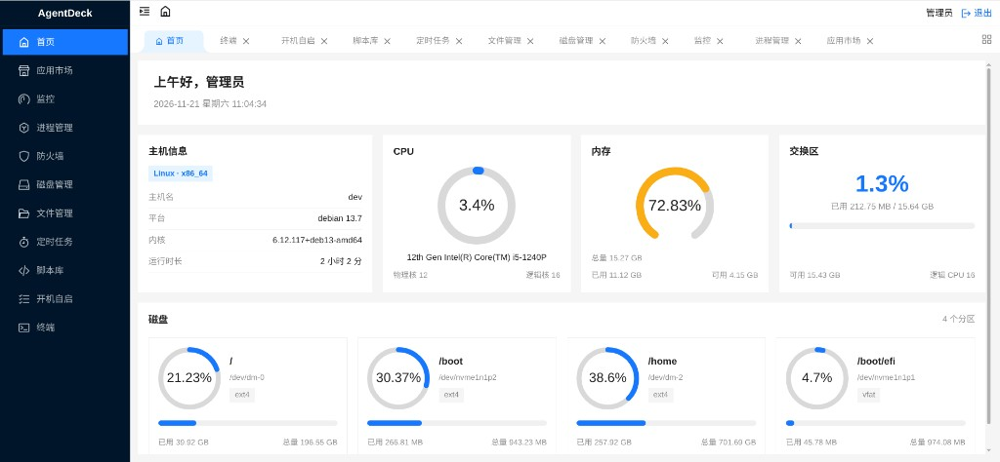
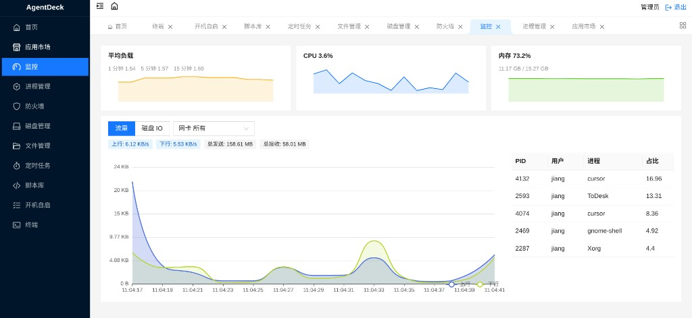
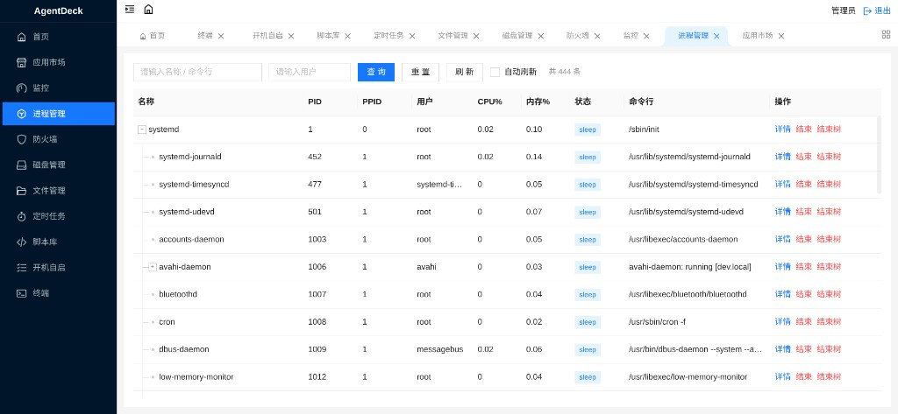
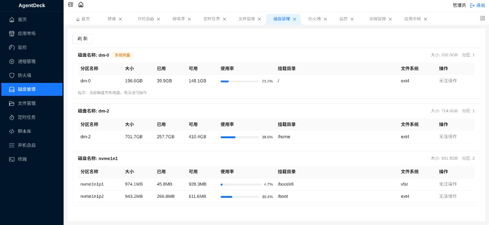

<div align="center">

# AgentDeck

**基础设施管理面板**

Gin + SQLite + Vue3 · 单可执行文件 · 主机、进程、任务、终端、磁盘与防火墙

[](https://go.dev/)
[](https://gin-gonic.com/)
[](https://vuejs.org/)
[](https://github.com/antdv-next/antdv-next)
[](./LICENSE)

</div>

> 在自己的机器上开一个面板：看资源、管进程和计划任务、改防火墙、看磁盘。前端打进同一个可执行文件，拷过去就能跑。

---

## 目录

- [特性](#特性)
- [界面](#界面)
- [技术栈](#技术栈)
- [目录结构](#目录结构)
- [环境依赖](#环境依赖)
- [快速开始](#快速开始)
- [构建](#构建)
- [说明](#说明)
- [关于](#关于)
- [许可证](#许可证)

## 特性

- **主机概况**：系统信息、CPU、内存、交换区、磁盘占用
- **实时监控**：负载、CPU、内存、磁盘 IO、网卡流量，以及当前最吃 CPU 的进程。曲线只留在页面里，不落库
- **进程**：按父子关系展开，可结束进程或进程树；详情含内存、打开的文件、环境变量和网络连接
- **定时任务 / 开机自启**：命令用编辑器编写，可先试运行
- **脚本库**：分组管理多行脚本；非交互可在本机或 SSH 主机执行，交互式注入终端
- **终端**：本机多标签 PTY；SSH 主机与分组、快速命令注入、字体/主题配置
- **磁盘**：分区容量与使用率。系统盘只查看
- **文件管理**：浏览本机目录，新建/重命名/复制/移动，上传下载；删除进回收站可还原；文本文件用 Monaco 在线编辑
- **防火墙**：查看并修改规则，支持开关、增删改、导入导出。Linux 走 ufw，Windows 走系统防火墙
- **应用目录**：分类、搜索、是否已安装。安装流程尚未接入
- **单文件运行**：无独立配置文件；SQLite 放在可执行文件旁的 `data/agentdeck.db`
- **登录**：Cookie 会话。只有登录请求走国密，其余接口是 JSON

## 界面

首页



监控



进程管理



磁盘管理



## 技术栈

| 层 | 选型 |
|----|------|
| 服务 | Go · Gin · GORM · SQLite · gopsutil · WebSocket/PTY/SSH |
| 页面 | Vue 3 · TypeScript · Vite · antdv-next · Tailwind · ECharts · xterm.js |
| 登录传输 | SM2 协商 + SM4 包体 |

## 目录结构

```text
cmd/server                 启动入口
internal/modular           登录、主机、进程、任务、脚本、终端、自启、监控、防火墙、磁盘、文件、应用目录
internal/pkg/platform      各系统命令差异（计划任务、自启、防火墙、文件根路径、终端 PTY）
internal/webembed          编译时嵌入前端；dist 由 make web 生成，不入库
web/src/views              页面对应上面这些能力
docs/images                README 界面截图
```

## 环境依赖

- Go 1.27+
- Node.js 与 pnpm（只在构建或开发前端时需要）
- 改防火墙、文件管理读写系统目录、本机终端、看其它用户进程细节等需要管理员权限：Linux/macOS 用 root 跑二进制，Windows 用管理员运行。Linux 防火墙依赖 ufw，未安装时可在页面里在线或离线安装

## 快速开始

分开开发时开两个终端：

```bash
make dev-api   # 后端 :8080
make dev-web   # 前端 :5173，/api 代理到后端
```

- 日常看页面：<http://127.0.0.1:5173>
- 只跑后端并带页面时：先 `make build`，再打开 <http://127.0.0.1:8080>
- 首次启动管理员：`admin` / `admin123`

## 构建

```bash
make build
./bin/agentdeck
```

`make build` 会先构建前端并嵌进可执行文件。交叉编译前先执行 `make web`：

```bash
CGO_ENABLED=0 GOOS=linux GOARCH=amd64 go build -o bin/agentdeck ./cmd/server
CGO_ENABLED=0 GOOS=windows GOARCH=amd64 go build -o bin/agentdeck.exe ./cmd/server
```

## 说明

- 生产环境直接跑可执行文件即可，例如 `sudo ./bin/agentdeck` 或 Windows 管理员运行 `agentdeck.exe`。`make dev-api-sudo` 只用于本机开发。
- 文件管理可浏览本机磁盘（Linux/macOS 从 `/`，Windows 从盘符）；读写受进程权限限制，文本编辑上限 2MB，更大请下载。删除先进入 `data/trash` 回收站，可还原或彻底清空。
- 防火墙按系统自动选用后端：Linux 用 ufw，Windows 用系统防火墙，macOS 用 pf anchor。关闭、删除和重置会立刻作用到本机，操作前会再确认。
- Linux 没有 ufw 时，防火墙页面会给出在线或离线安装，装好之后才能改规则。
- 终端 WebSocket 走登录 Cookie；SSH 主机密码/私钥以 SM4 密文存于库中，接口不回明文。默认忽略 SSH 主机指纹（可在终端配置关闭）。
- 字段一律 `snake_case`。成功时响应 `code` 为 `0`。

## 关于

AgentDeck 由 [jiangbyte](https://github.com/jiangfolio) 开发，用来在自己的机器上管理主机、进程、任务、文件、防火墙和终端。

源码仓库：[github.com/jiangfolio/AgentDeck](https://github.com/jiangfolio/AgentDeck)

## 许可证

本项目基于 [Apache License 2.0](./LICENSE) 开源。
